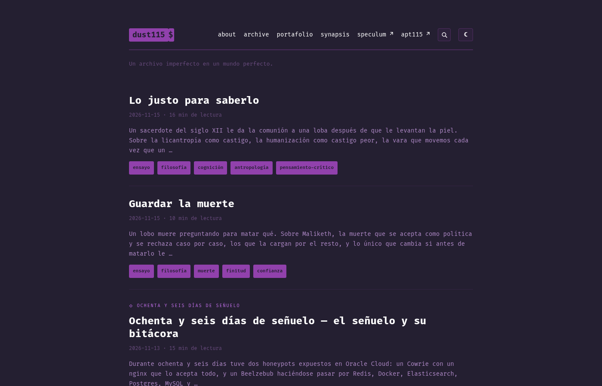
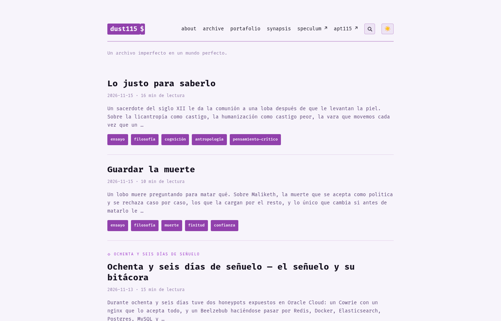
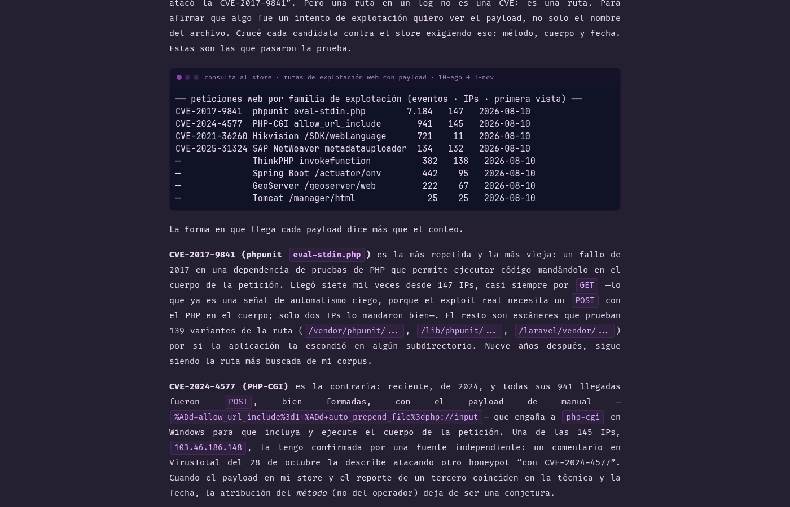
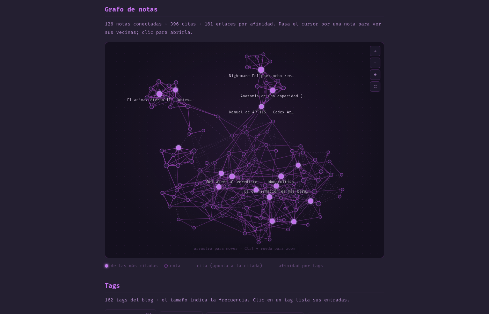

# Vulpine Marrow — tema Hugo

Tema del archivo digital **Dust115**. Violeta profundo sobre negro, tipografía
**Fira Code**, estética HUD «terminal-clean». Es un tema **autónomo**: deriva del
tema [Terminal](https://github.com/panr/hugo-theme-terminal) de panr (MIT) pero
ya **no depende de él** — las piezas base necesarias están vendorizadas dentro
del tema (ver `LICENSE.md`).

Pensado para un blog técnico que también es un jardín de notas: posts que se
citan entre sí, un mapa navegable de esas conexiones, búsqueda completa y
exportación a PDF, todo **sin CDN ni dependencias externas** en tiempo de
ejecución.

> El sistema de diseño que da nombre al tema («Vulpine Marrow») tiene su fuente
> de verdad en la herramienta **/apt115/** del sitio; este tema es la
> implementación de ese lenguaje visual para el blog.



**Versión actual: 0.6.0** — ver [`CHANGELOG.md`](CHANGELOG.md). Demo en vivo:
[fennek.org](https://fennek.org/).

## Novedades de 0.6.0

- **Synapsis reescrito**: el grafo deja mermaid por una red de fuerzas propia
  en SVG. El layout es ~4× más rápido, se guarda en `localStorage` (desde la
  segunda visita no se recalcula) y se arma después del primer pintado; el
  pan/zoom se mueve por GPU. Clic en un nodo abre el post.
- **Shortcode `terminal`**: ventana de terminal con comando copiable y salida
  literal; `max="N"` pliega las líneas sobrantes sin JS.
- **Filtro por año** en la búsqueda y en Synapsis (`?y=` en la URL).
- **Enlaces externos en pestaña nueva** (render hook de enlaces).
- **`code` dentro de un enlace** se distingue del `code` suelto.
- **Sin CDN**: mermaid autohospedado y `@font-face` inline con `preload`.
- La serie fija (tipo libro) pasa a ser **opt-in** y genérica.

## Instalación

```toml
# hugo.toml
theme = "vulpine-marrow"
```

Coloca el tema en `themes/vulpine-marrow/`. Requiere Hugo **extended** ≥ 0.128
(usa `resources.Concat`, `minify`, `fingerprint` y `Page.Store`). La
configuración completa (params, menú, búsqueda, contenido relacionado) está en
[`docs/configuration.md`](docs/configuration.md).

## Sitio de ejemplo

`exampleSite/` trae una demo con posts genéricos que ejercitan las features
principales: código, callouts, comandos copiables, `terminal`, mermaid,
figuras, wikilinks y backlinks, la página Synapsis, la búsqueda (`/buscar/`) y
el portafolio. Para previsualizarla:

```bash
cd exampleSite
hugo server --themesDir ../..
```

|  |  |
|---|---|
|  |  |
|  |  |

## Características

### Lectura y estilo

- **Modo claro / oscuro** con toggle en el header (`☾`/`☀`). El estado se
  guarda en `localStorage` (`vm-theme`) y se aplica antes del primer pintado
  (script anti-FOUC en `extended_head.html`); la clase `.vm-light` en `<html>`
  conmuta toda la paleta vía tokens.
- **Tokens del design system** (`assets/css/tokens/`): colores, tipografía y
  spacing. El skin (`assets/css/skin/`) puentea las variables del tema a los
  tokens `--vm-*`, así el modo claro se propaga solo.
- **Fira Code autohospedada** (`static/vm/fonts/`, 7 subsets woff2).
- **Layout de lectura de un solo ancho**: header, prosa, imágenes y footer
  alineados al mismo borde; prosa justificada e imágenes centradas.
- **Listado feed** de columna única (`partials/post-card.html`): serie ⟐,
  título, meta, summary y chips de tag — sin covers. Usado por home, `/posts`
  y páginas de tag.
- **Tablas responsive** (render hook `render-table.html`): scroll horizontal
  dentro de su caja, sin cortes a mitad de palabra (tampoco en enlaces o
  `code`) y una sombra violeta que indica que hay más tabla en móvil.
- **Highlighting de sintaxis** (Chroma, clases) + botón de copia en bloques de
  código (`assets/js/code.js`).
- **`code` dentro de enlaces** con borde de acento y subrayado punteado (un
  hash que lleva a VirusTotal se ve como enlace, no como texto).
- **Enlaces externos** en pestaña nueva con `rel="noopener noreferrer"`
  (render hook `render-link.html`); anclas y enlaces internos siguen igual.
- **Lightbox** sin dependencias para imágenes, SVG y diagramas: zoom con rueda,
  arrastre, pellizco en táctil y teclado (`+` `-` `0` `Esc`).
- **Botón «subir al inicio»** (`#vm-top`) que aparece al bajar y respeta
  `prefers-reduced-motion`.
- **Tabla de contenidos** opt-in por página (`toc: true`).

### Diagramas

- **Mermaid theme-aware y autohospedado** (v11.16.0,
  `static/vm/js/mermaid.min.js`): render hook para ```` ```mermaid ````; se
  carga solo en páginas que lo usan y se **re-renderiza al cambiar de tema** con
  paletas violeta para claro y oscuro. Conserva los `<br/>` de las etiquetas.

### Jardín de notas

- **Wikilinks** `[[clave]]` / `[[clave|alias]]` (`partials/wikilinks.html`,
  post-procesa el HTML ya renderizado) y **backlinks** «Mencionado en»
  (`partials/backlinks.html`). La clave es el último segmento del
  `RelPermalink`.
- **Notas relacionadas** al pie de cada post (`partials/related.html`), con el
  motor de contenido relacionado de Hugo (tags, serie, fecha).
- **Synapsis** (`_default/synapsis.html` + `js/synapsis.js`): página-hub con un
  grafo de fuerzas propio en SVG, sin dependencias. Dos tipos de arista: citas
  por wikilink (flecha sólida) y afinidad por tags (punteada). Tamaño de nodo
  por conexiones, las notas más citadas resaltadas, etiquetas sin choques,
  hover con vecinas, pan/zoom, encuadre y pantalla completa, layout
  transpuesto en móvil y colores desde los tokens.
  - **Rendimiento**: layout con arreglos tipados (~4× más rápido), cacheado
    en `localStorage` por hash de los datos y armado después del primer
    pintado; pan/zoom en vivo con transform CSS sobre una capa GPU; el hover
    solo toca la nota y sus vecinas; `ResizeObserver`.
  - **Grupos de color** opcionales por nodo (`g` 0–9, paleta desde los tokens)
    y muestras `.syn-swatch` para leyendas.
  - Nube de tags e índice cronológico, con **filtro por año** que atenúa lo de
    fuera y encuadra lo de dentro (sin recalcular el layout).
  - Úsala con `layout: "synapsis"` en una página.

### Navegación y descubrimiento

- **Búsqueda full-text** sin dependencias (`/buscar/`, lupa en el header):
  índice `index.json` generado en build + `js/search.js`. Ranking por campo
  (título, tag, summary, cuerpo), resaltado de coincidencias, snippet de
  contexto y query en la URL (`?q=`).
- **Filtro por año** (`partials/year-filter.html` + `js/yearfilter.js`,
  sincronizado con `?y=`), compartido por la búsqueda y Synapsis.
- **Portafolio** (`/portafolio/`): landing que reúne los posts con el tag
  `proyecto` sin sacarlos del stream del blog.
- **Serie fija opt-in** (`params.codiceSeries` / `codiceIndex`): una serie tipo
  libro con orden de lectura por `weight`, navegación prev/next propia que no
  se mezcla con la del blog (`partials/posts_pagination.html`) y el shortcode
  `codice-list` para su índice. Sin configurar, todas las páginas son posts
  normales.
- **Orden por fecha explícito** en home, `/posts`, RSS e `index.json` (el orden
  por defecto de Hugo pondría primero las páginas con `weight`).
- **Menú** con marca `↗` para enlaces externos, favicon completo (ico, svg,
  png) e icono para iOS.

### Exportación a PDF

- **Vista de impresión por post** (output format `print`,
  `/posts/<slug>/print.html`): página clara A4 con portada, índice, pie con
  número de página y reglas anti-corte (tablas con cabecera repetida, títulos
  que no quedan colgados al pie).
- **Constructor de informes** (`/informes/`): elige posts y su orden y arma un
  solo PDF en el navegador, con portada e índice maestros, números de página
  reales y referencias consolidadas. La selección viaja en la URL, así que
  cualquier combinación es un enlace reproducible. Paginado con Paged.js 0.4.3
  (vendorizado).
- **Whitepapers** (`layouts/whitepapers/`): documentos curados con landing
  HTML, vista imprimible y descarga del PDF pre-generado. Ver
  [`docs/whitepapers.md`](docs/whitepapers.md).
- Señal `data-pf-ready` en `<html>` para scripts headless que pre-generan los
  PDF.

### Rendimiento

- **Un solo bundle CSS** (tokens → base → skin) y **un bundle JS**, ambos
  minificados y con `fingerprint`; el JS va con `defer`.
- `@font-face` **inline** en el `<head>` + `preload` del subset latino: un
  request bloqueante menos.
- Cero peticiones a terceros: fuentes, mermaid y Paged.js se sirven desde el
  propio sitio.

## Shortcodes

Referencia de uso completa con ejemplos en
[`docs/shortcodes.md`](docs/shortcodes.md).

| Shortcode | Propósito |
|-----------|-----------|
| `listening` | Bloque «escuchando ahora» (track/artist/album) |
| `ascii` | Envuelve arte braille/ASCII con tamaño correcto |
| `commit` | Pie estilo git-commit |
| `codice-list` | Lista capítulos de la serie `codiceSeries` por rango de `weight` |
| `callout` | Aside resaltado (info/tip/warning/danger) |
| `command` | Bloque de comando copiable |
| `terminal` | Ventana de terminal: comando copiable + salida literal, plegable con `max` |
| `figure` | Imagen con caption + crédito (resuelve page-bundle) |
| `badge` | Etiqueta inline de color por token |
| `tlp` | Banner Traffic Light Protocol (clear/green/amber/red) |

Además hay dos de uso interno: `codice-svg` (inserta una pieza SVG de
`partials/codice-svg/`) y `raw-html` (HTML literal).

## Documentación

- [`docs/architecture.md`](docs/architecture.md) — cómo está construido por
  dentro: origen standalone, herencia de plantillas, pipelines de CSS y JS.
- [`docs/configuration.md`](docs/configuration.md) — parámetros de `hugo.toml`,
  menú, búsqueda, contenido relacionado y estructura de contenido esperada.
- [`docs/features.md`](docs/features.md) — cómo funciona cada feature en
  detalle.
- [`docs/shortcodes.md`](docs/shortcodes.md) — referencia de los shortcodes.
- [`docs/whitepapers.md`](docs/whitepapers.md) — documentos PDF curados.
- [`CHANGELOG.md`](CHANGELOG.md) — historial de versiones.

## Estructura

```
themes/vulpine-marrow/
├── theme.toml
├── README.md · CHANGELOG.md
├── LICENSE.md                  # MIT propio + atribución a panr/Terminal y terceros
├── layouts/
│   ├── _default/               # baseof, single, list, term, terms, synapsis,
│   │   │                       # search, rss.xml, single.print
│   │   └── _markup/            # render hooks: mermaid, enlaces, tablas
│   ├── index.html · index.json · 404.html · robots.txt
│   ├── informes/               # constructor de informes PDF (list + list.print)
│   ├── whitepapers/            # landing + vista imprimible
│   ├── portafolio/             # landing por tag `proyecto`
│   ├── partials/               # head, header, footer, post-card, post-date,
│   │                           # pagination, posts_pagination, wikilinks,
│   │                           # backlinks, related, year-filter, logo,
│   │                           # cover, comments, extended_head/footer
│   └── shortcodes/
├── assets/
│   ├── css/
│   │   ├── tokens/             # colors, typography, spacing (design system)
│   │   ├── base/               # CSS base vendorizado de Terminal (MIT)
│   │   ├── skin/               # overrides Vulpine Marrow (01..11, ordenados)
│   │   └── print/              # report, collection, whitepaper (PDF)
│   └── js/                     # code, menu, lightbox, backtotop, search,
│                               # yearfilter, synapsis, print-*, informe/whitepaper
├── static/
│   ├── vm/fonts/               # Fira Code woff2 + licencia OFL
│   ├── vm/js/                  # mermaid.min.js, paged.polyfill.min.js
│   ├── vm/tokens/fonts.css     # @font-face para los layouts print
│   └── apple-touch-icon.png
├── docs/
├── exampleSite/
└── images/                     # capturas
```

### Carga de CSS

`partials/head.html` arma **un solo bundle** concatenando, en orden explícito:
`tokens → base (Terminal) → skin (overrides)`, luego `minify` + `fingerprint`.
Los `@font-face` van **inline** en el `<head>` (con `url()` vía `absURL`,
segura bajo un `baseURL` con subpath) más un `preload` del subset latino:
ahorra un request bloqueante y adelanta el descubrimiento de la fuente.
`static/vm/tokens/fonts.css` queda para los layouts *print* (PDF).

## Atribución

Deriva del tema **Terminal** de panr (MIT). Incluye Fira Code (OFL), mermaid
(MIT) y Paged.js (MIT). Ver `LICENSE.md`.
